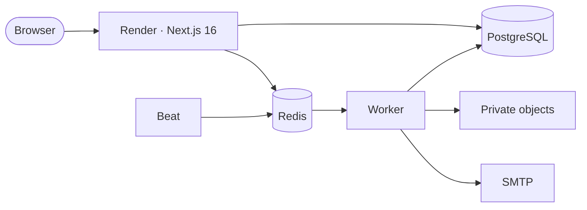

<picture>
  <source media="(prefers-color-scheme: dark)" srcset="docs/readme/banner-dark.png" />
  <source media="(prefers-color-scheme: light)" srcset="docs/readme/banner.png" />
  
</picture>

<p align="center">
  <a href="LICENSE"></a>
  <a href="https://nextjs.org"></a>
  <a href="docs/DEVELOPMENT.md"></a>
  <a href="docs/DEPLOYMENT_VPS.md"></a>
</p>

<p align="center">
  <a href="#host-it-on-a-vps-with-docker">Host on a VPS</a> ·
  <a href="#run-it-for-free">Free cloud hosting</a> ·
  <a href="#quick-start-local">Quick start</a> ·
  <a href="docs/README.md">Documentation</a> ·
  <a href="CONTRIBUTING.md">Contributing</a> ·
  <a href="#credits">Credits</a>
</p>

**Space Works Workspace is the free, open-source, self-hosted operations tool
for the team that runs an organisation.** Non-profits, NGOs, community offices,
makerspace operating teams and small startups plan work, run money, look after
people, keep governance in order and manage application secrets in one place.
It started with the Space Works maker community at TinkerSpace Kochi. Every
record, file and secret stays on infrastructure you control, with separate
workspaces, roles and an audit trail.

Member-facing work lives in the sibling apps: [Space Works](https://github.com/SpaceWorks-Labs/SpaceWorks)
for the makerspace itself, [Space Works Events](https://github.com/SpaceWorks-Labs/SpaceWorks-Events)
for events and tickets, and [Space Works Organization](https://github.com/SpaceWorks-Labs/SpaceWorks-Organization)
for memberships.

## What you can do

Simple tools with manual entry, grouped the way an operating team works.

### Work and projects

- Projects with kanban boards, a timeline, milestones, dependencies, blockers and weekly status updates.
- Tasks with assignees, priorities, subtasks, recurrence, checklists and short task links; printable project reports.
- Meetings with agendas, decisions and action items; goals, key results, polls and ideas.
- A team calendar with recurring meetings, invitations, RSVPs, Google Calendar sync and Google Meet links.

### Chat and knowledge

- Channels, direct messages, threads, reactions, mentions and live updates.
- Rich-text docs with revisions, SOP review reminders and controlled access; private files with versions in Silo.
- Global search and a command palette that only show what each member can open.

### People and organisation

- Member profiles, departments, reporting lines and an org chart; a responsibilities register with backups.
- Onboarding and offboarding, skills, training sign-offs, leave balances, attendance and volunteer hours.
- Hiring openings and candidates, rota and shift swaps, escalation paths, a confidential help desk and a safety log.

### Money

- Income and expenses, funds and restricted funds, cost centres, budgets and month-end close.
- Supplier bills, purchase requests with approvals, reimbursements, receipt uploads and spend review.
- Rent, utilities and other recurring costs; PF, ESI, PT and TDS remittances; staff advances, loan EMIs and insurance premiums, all on one upcoming-dues list.
- Payroll records and disbursements, petty cash, deposits, depreciation and TDS registers.
- Funding: grants, CSR, donations, campaigns, pledges, donor receipts and impact reports.
- Documents: GST invoices and notes, receipts, 80G and utilisation certificates, and letters.

### Governance

- A compliance calendar, board meetings and resolutions, vendors and contracts.
- Insurance and statutory registers, risks and drills, conflict-of-interest links and frozen board packs.
- Restricted safeguarding and POSH cases with explicit case access.

### Product, marketing and IT

- A roadmap, releases with approvals, an issue and QA tracker, prototype tests and a change log.
- BOM cost estimates for funding proposals, with GST, contingency and a printable budget sheet.
- A content calendar, a brand asset library, and proposals and outreach with follow-ups.
- Device and licence registers, a security incident log, access reviews and restore-test records.

### Secrets

- Application secrets by project, environment and folder, in the spirit of [Infisical](https://github.com/Infisical/infisical).
- Envelope encryption under a rotatable root key, version history, snapshots and point-in-time rollback.
- Masked values with audited reveal and copy, fresh-MFA access to production and change approvals.
- Machine identities with short-lived access tokens, one-time share links and a security overview.
- The `sww` command line and Node SDK, installed with npm from GitHub Packages (see [Secrets CLI](#secrets-cli)).

### Reports and analytics

- One report desk across money, funding, people, work and operations, with period comparisons.
- Drill-down from every number, CSV exports, a cash-flow forecast and printable management and board packs.

### Services, alerts and integrations

- HTTP, TCP, DNS, TLS and heartbeat checks; incidents, maintenance, on-call and public status pages.
- Cloud accounts and costs for DigitalOcean, AWS, Vercel, Contabo and other providers.
- Reminders and alerts by email, WhatsApp, Telegram, Slack, Discord and Mattermost, sent by the background worker.
- Social analytics and comments, app store reviews, GitHub, and the Space Works Assistant.
- A private notepad with to-dos for every member.

### Run it safely

- Strict workspace isolation and OWNER, ADMIN, MEMBER and GUEST roles.
- Invite-only membership, password and optional Google/OIDC sign-in, MFA and session revocation.
- Audit, rate limits, CSP nonces and private object storage in Silo.
- Background jobs on a BullMQ worker and beat, two release images, guided VPS operations and encrypted off-site backups.

See the [area guides](docs/README.md#feature-areas) for implemented contracts and limits.

## A look around

Taken on the seeded demo workspace with `scripts/capture-readme-screens.mjs`.

<table>
  <tr>
    <td width="50%" valign="top"><p><strong>My day.</strong> Tasks, meetings, dues and recent activity in one place.</p></td>
    <td width="50%" valign="top"><p><strong>Project board.</strong> Milestones, blockers and the next build.</p></td>
  </tr>
  <tr>
    <td width="50%" valign="top"><p><strong>Calendar.</strong> Meetings, deadlines and Google Meet links together.</p></td>
    <td width="50%" valign="top"><p><strong>Chat.</strong> Channels, threads and the team’s conversations.</p></td>
  </tr>
  <tr>
    <td width="50%" valign="top"><p><strong>Docs.</strong> SOPs and shared knowledge with history and controlled access.</p></td>
    <td width="50%" valign="top"><p><strong>Notepad.</strong> Your private notes and to-dos.</p></td>
  </tr>
  <tr>
    <td width="50%" valign="top"><p><strong>Finance, dark mode.</strong> Funds, bills and recent spending.</p></td>
    <td width="50%" valign="top"><p><strong>Upcoming dues.</strong> Rent, utilities, remittances, EMIs and premiums on one list.</p></td>
  </tr>
  <tr>
    <td width="50%" valign="top"><p><strong>Funding.</strong> Grants, CSR, donations and the reports funders expect.</p></td>
    <td width="50%" valign="top"><p><strong>Reports.</strong> Period comparisons, drill-downs and board packs.</p></td>
  </tr>
  <tr>
    <td width="50%" valign="top"><p><strong>Secrets.</strong> Environments, masked values and audited reveal.</p></td>
    <td width="50%" valign="top"><p><strong>BOM estimates.</strong> Cost a project for a funding proposal.</p></td>
  </tr>
  <tr>
    <td width="50%" valign="top"><p><strong>Governance.</strong> Compliance dates, board decisions and registers.</p></td>
    <td width="50%" valign="top"><p><strong>Organisation.</strong> Departments, reporting lines and responsibilities.</p></td>
  </tr>
  <tr>
    <td width="50%" valign="top"><p><strong>Services.</strong> Checks, incidents and uptime in one place.</p></td>
    <td width="50%" valign="top"><p><strong>Help desk.</strong> Internal requests with owners, targets and confidential handling.</p></td>
  </tr>
</table>

## Secrets CLI

Install Node 20 or newer. GitHub Packages is the primary registry for the `sww`
command line and Node SDK. Authenticate first, then install the package:

```bash
npm login --scope=@spaceworks-labs --auth-type=legacy --registry=https://npm.pkg.github.com
npm install --global @spaceworks-labs/workspace-cli
```

At the prompts, enter your GitHub username and a personal access token
(classic) with `read:packages` as the password. Authorize the token for your
organization's SSO if required. Enter it only at the prompt, not in a command
argument or a committed file. GitHub Packages requires authentication even for
public packages; see [GitHub's npm registry guide](https://docs.github.com/en/packages/working-with-a-github-packages-registry/working-with-the-npm-registry).

Then link a repository and run your app with its secrets injected:

```bash
sww login --host https://workspace.example.org
sww init --project PROJECT_ID --env dev
sww run --env dev -- npm run dev
```

Export a file when you need one (production needs a fresh MFA code), or log
in as a machine identity in CI:

```bash
sww export --env production --format dotenv --mfa 123456 > .env
export SWW_TOKEN="$(sww login --method=universal-auth --client-id "$CLIENT_ID" --client-secret "$CLIENT_SECRET" --plain --silent)"
sww scan --staged
```

Main releases automatically publish the CLI to GitHub Packages at the same
base version as the images. Publishing to npmjs.com is optional and requires
the repository's `NPM_TOKEN` secret. A bare install against the default public
npm registry can return 404 when that optional publication is not configured;
use the authenticated GitHub Packages flow above.

The [CLI guide](packages/cli/README.md) covers the SDK, keychain storage and
secret scanning.

## Host it on a VPS with Docker

**Yes — the complete application runs on your own VPS, installed with one line.**
It ships as a **backend** image (the API, which also runs the
database migrations and operator tools) and a **frontend** image (the website).
The production Docker Compose stack runs them with **PostgreSQL 16**,
**Redis 7**, private **[Silo](https://github.com/pgsty/silo)** object storage (the
maintained, S3-compatible fork of the archived MinIO) for private documents and files,
automatic public HTTPS with Caddy, database migrations, a BullMQ worker and
beat for scheduled jobs. Only a domain and an authenticated SMTP relay are external; Render,
Supabase, Upstash and Cloudflare are optional hosting choices.

### Install in one line

On a 64-bit Linux server (Ubuntu/Debian, Fedora/RHEL/Alma/Rocky, Arch or openSUSE),
as root or a user with `sudo`:

```bash
curl -fsSL https://raw.githubusercontent.com/SpaceWorks-Labs/SpaceWorks-Workspace/main/install.sh | bash
```

It checks the server, picks the latest [release](https://github.com/SpaceWorks-Labs/SpaceWorks-Workspace/releases)
and asks every question first: the layout (by default the website and API
containers both on this VPS, at `workspace.example.com` and `api.workspace.example.com`;
or one app container on one hostname; or the website on Netlify), hostnames, the
super-admin email, HTTPS (automatic Let's Encrypt, a LAN/trial certificate, or
your existing reverse proxy), file storage (bundled Silo or an external S3/R2
bucket), your SMTP relay (Brevo is prefilled on port 2525) and whether to set up
automatic deploys. Invalid answers are asked again. One summary lists every choice and host
change, and **nothing changes until you confirm it**. Then it installs Docker if
needed, generates every secret and internal TLS certificate without printing them,
downloads the release's ready-made images from
[GitHub Packages](docs/CONTAINER_IMAGES.md) (amd64 and arm64), migrates and
checks that each service is healthy. The application images are prebuilt; the
bundled standard Caddy edge is compiled locally from pinned source with patched
Go and dependencies. An existing reverse proxy skips that build.

**Before you start:** 2 vCPU, 4 GB RAM with swap available and 30 GB SSD as a
starting estimate for the bundled edge and a small instance, DNS A
records pointing at the server (two for the default layout), inbound ports 80 and 443, an SMTP
relay on a verified sending domain, and your super-admin email.

### Update, back up and check

Run the same command again. An existing installation shows a menu:

1. **Update to the latest release** — backs up the database and configuration,
   downloads the new images while the site keeps running, migrates and restarts. If
   the new release is not healthy, the previous one is restored automatically.
2. **Back up now** — database, configuration and uploaded files, into
   `/etc/spaceworks-workspace/backups/`.
3. **Check status and health** — services, disk, newest backup and live checks.
4. **Backups** — nightly schedule, retention, encryption to a key you keep off the
   server (`age`), and copies to an off-site S3 bucket. Check backup freshness from the installer status command.
5. **Change settings** — hostnames, outgoing email (SMTP) or bucket credentials;
   rolled back automatically if the checks fail.
6. **Server security** — a firewall allowing only SSH, HTTP and HTTPS, automatic
   security updates and fail2ban.
7. **Automatic deploys** — install (or remove) a GitHub Actions runner so every
   published release updates the server by itself, when each release is published.
8. **Recover super-admin access** — for a lost authenticator or password: resets
   MFA and prints a one-hour reset link.
9. **Support bundle** — checks and recent logs with secrets redacted.
10. **Uninstall** — keeps the data, secrets and backups unless you type `DELETE DATA`.

`0` (the default) cancels without changing anything.

The internal service certificates renew themselves before they expire (a weekly
systemd check), and setup asks about backups and hardening up front.

Releases live in `/opt/spaceworks-workspace/releases/<commit>` with `current` pointing
at the running one; secrets stay in `/etc/spaceworks-workspace`. Options: `--release`
for a specific release, `--ref` to build a branch or commit from source (needs
4 GB of memory), `--repo` for a fork, `--dir` for another location and `--update`
to skip the menu; `bash install.sh --help` lists them. A new release is published
by the first `main` build of each new `VERSION`. A restore is a
deliberate step: `sudo bash /opt/spaceworks-workspace/current/scripts/vps-restore.sh <backup>`.

The installer does not change DNS or provision SMTP. The
**[complete VPS guide](docs/DEPLOYMENT_VPS.md)** covers manual
installation from a checkout, updates, rollback, backups and restores, internal
certificate renewal and monitoring. Use `compose.production.yml`; the development
and staging Compose files are not production setups.

### Netlify + VPS

Choose **3** in the installer to render the shared Next.js UI on Netlify while
authentication, tenant data, files, jobs and actions stay on the VPS. Browser
APIs use the frontend origin; authenticated realtime streams go directly to the
backend with short-lived, one-use tickets. The default VPS layout uses the same
`frontend/` workspace in a container.

Copy the generated `frontend.env` values to Netlify, set **Package directory =
frontend**, keep **Base directory = repository root**, and use
`frontend/netlify.toml`. Deploy the same source revision on both hosts. The
frontend holds only URLs, a private gateway credential and its own action key.
Follow [Netlify + VPS](docs/DEPLOYMENT_SPLIT.md).

Private repositories and packages can use `SWW_GITHUB_TOKEN`; public installs
need nothing. See [private installs](docs/DEPLOYMENT_VPS.md#private-repositories-and-packages).

## Cloud hosting

The [Render Blueprint](render.yaml) runs web, worker and beat on paid compute,
with managed PostgreSQL, persistent native Redis and private object storage.
A free web plan needs an independently hosted worker; Cloudflare cron can
replace beat by calling the two enqueue endpoints every minute. Worker handles
email, notifications, scheduled jobs, syncs and monitor checks.



[Deploy to Render](https://render.com/deploy?repo=https://github.com/SpaceWorks-Labs/SpaceWorks-Workspace).
The [cloud guide](docs/DEPLOYMENT_CLOUD.md) covers secrets, TLS, SMTP, workers,
first-run setup and free-plan limits. [Jobs operations](docs/areas/jobs-queue.md)
covers retries, health and recovery. Docker, AWS, DigitalOcean and Kubernetes
remain supported alternatives.

## Quick start (local)

Use Node.js 22 and Docker. The development Compose file provides PostgreSQL 16,
persistent Redis 7, private Silo storage and Mailpit for captured local email.

```bash
npm ci
cp .env.example .env
docker compose up -d --wait
npm run db:deploy
npm run storage:init
DEMO_PASSWORD='choose-12-or-more-characters' npm run db:seed:demo
PORT=3290 npm run dev:stack
```

Set `AUTH_URL` and `NEXT_PUBLIC_BASE_URL` in your local configuration to
`http://localhost:3290`. Open that address and sign in as
`owner@tinkerspace.test` with your demo password. The seed creates a community
workspace and loads every module in `scripts/seed/`. The local supervisor starts
web, worker and beat together, stops siblings on failure and drains workers when
you stop it. Worker and beat health use separate loopback ports 3460 and 3461;
inspect email at `http://localhost:8025`. On PowerShell set `$env:PORT='3290'`
before `npm run dev:stack`. Local service checks refuse remote database, Redis,
storage and SMTP targets before local migrations run. See
[Local development](docs/DEVELOPMENT.md).

## Design system

Gilroy, flat cards, teal actions, a Citron sidebar and one bold accent moment.

| | Colour | Used for |
| --- | --- | --- |
|  | Deep Ink | Text and dark surfaces |
|  | Warm Cream | Canvas and inverse labels |
|  | Maker Teal | Actions, links and focus |
|  | Workshop Orange | Accent fill with an ink label |
|  | Citron | Sidebar and selection |
|  | Sky Blue | Information |
|  | Warm Yellow | Warnings |

Read [the design guide](docs/DESIGN.md). Regenerate the banners and swatches with
`npm run readme:art`. Screenshots are captured by an operator with
`DEMO_PASSWORD=... node scripts/capture-readme-screens.mjs http://localhost:3290`.

## Documentation

| Read this | When you want to |
| --- | --- |
| [Documentation index](docs/README.md) | Find feature areas and engineering guides |
| [Architecture](docs/ARCHITECTURE.md) | Understand tenancy, services and background work |
| [Configuration](docs/CONFIGURATION.md) | Look up settings and secrets |
| [VPS deployment](docs/DEPLOYMENT_VPS.md) | Install, update, back up and recover |
| [Netlify + VPS](docs/DEPLOYMENT_SPLIT.md) | Split frontend rendering and backend services |
| [Container images](docs/CONTAINER_IMAGES.md) | Understand VERSION, tags and GitHub Packages |
| [Cloud deployment](docs/DEPLOYMENT_CLOUD.md) | Use managed services and free plans |
| [Release procedure](docs/PRODUCTION_RELEASE.md) and [operations](docs/production-operations.md) | Ship and run it |

## Contributing

Read [CONTRIBUTING.md](CONTRIBUTING.md), [AGENTS.md](AGENTS.md) and the area guide
before making a change. Features branch from `dev`; `main` is production. Include
validation and update the relevant docs with behavior changes. Keep tenant and
role checks on the server, and keep credentials out of issues and logs.

## Credits

Made by **Space Works**, a maker community that started inside TinkerSpace Kochi.
The Space Works brand, design and community guide the product. Thanks to the
maintainers of the open-source technologies it runs on.

Licensed [AGPL-3.0-or-later](LICENSE). If you modify and host it, offer the matching
source to the people using your version.
