<picture>
  <source media="(prefers-color-scheme: dark)" srcset="docs/readme/banner-dark.png" />
  <source media="(prefers-color-scheme: light)" srcset="docs/readme/banner.png" />
  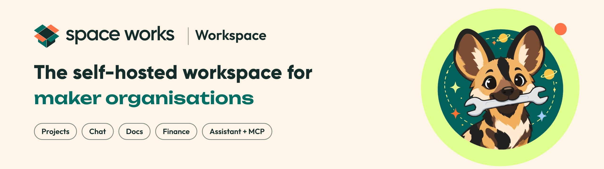
</picture>

<p align="center">
  <a href="CHANGELOG.md"></a>
  <a href="LICENSE"></a>
  <a href="docs/DEVELOPMENT.md"></a>
  <a href="https://nextjs.org"></a>
  <a href="docs/DEVELOPMENT.md"></a>
  <a href="https://github.com/SpaceWorks-Labs/SpaceWorks-Workspace/actions/workflows/quality.yml"></a>
</p>

<p align="center">
  <a href="#features">Features</a> ·
  <a href="#quick-start">Quick start</a> ·
  <a href="#deploy">Deploy</a> ·
  <a href="docs/README.md">Documentation</a> ·
  <a href="CONTRIBUTING.md">Contributing</a>
</p>

**Space Works Workspace is a free, open-source, self-hosted operations tool for
the team that runs a maker organisation, NGO or community office.** Plan work,
run the money, look after people, keep governance in order and manage
application secrets in one place, on infrastructure you control.

## Why

Small organisations stitch together a task tracker, a chat app, a document
store, a spreadsheet for money and a password manager, and then lose track of
who owns what. Space Works Workspace puts them in one tenant-isolated
application with roles, an audit trail and an AI assistant that works with the
same permissions as the person using it. Every record, file and secret stays on
your own server. It started with the Space Works maker community at TinkerSpace
Kochi. Member-facing work lives in sibling apps:
[Space Works](https://github.com/SpaceWorks-Labs/SpaceWorks),
[Events](https://github.com/SpaceWorks-Labs/SpaceWorks-Events) and
[Organization](https://github.com/SpaceWorks-Labs/SpaceWorks-Organization).

## Features

### Work

- **Projects** with kanban boards, timeline and report views, milestones, cycles and weekly status updates.
- **Tasks** with subtasks, dependencies, labels, recurrence, attachments, mentions and per-project task types; move a task to another project at any time.
  - Multiple assignees, one-click **Assign to me** and **Unassign me** on cards and in the drawer (shortcut `i`), and an assignment history that shows who assigned whom.
  - **My Tasks** tabs: Assigned to me, Assigned by me, My team and Created by me.
  - A **list view** with inline editing and bulk edit of up to 50 tasks.
  - A per-project **Restrict task edits** switch limits edits to the creator, assignees, project owner and admins.
  - An accessible drag-and-drop board (keyboard and touch) with a **Move to...** menu, and notifications when you are assigned or unassigned.
  - Board column colours and WIP limits, swimlanes, saved views, a creator filter, an archived tab with permanent delete, `/` and `j`/`k` shortcuts and images in descriptions.
- **Docs** with revisions, review reminders and controlled access; private **files** with versions.
- **Chat** with channels, direct messages, threads, reactions and mentions, plus a team calendar, meetings, goals, polls and ideas.

### Operations

- **Finance**: income and expenses, funds, budgets, supplier bills, purchase requests with approvals, reimbursements, rent and recurring costs, remittances, payroll records, funding and donor receipts.
  - Bank statement import (CSV, OFX) with matching, and Tally, Xero, QuickBooks and journal exports ([guide](docs/areas/finance-bank-export.md)).
  - Receipts and Payments, Income and Expenditure and fund statements by financial year, donations posted to the ledger, and FCRA checks ([guide](docs/areas/finance-statements.md)).
  - Invoice payment links through your own Stripe or Razorpay account, with signed webhooks and refunds ([guide](docs/areas/payments.md)).
  - In-kind gifts recorded as assets, and your own accounting codes on accounts and categories for the exports.
- **Makerspace operations**: machine downtime, maintenance reminders, required inductions with a sign-off matrix, and consumables stock with reorder alerts ([guide](docs/areas/makerspace-ops.md)).
- **Email campaigns**: native lists, double opt-in, templates, throttled sending, bounce handling and one-click unsubscribe, with tracking off by default ([guide](docs/areas/email-campaigns.md)).
- **People**: profiles, org chart, onboarding, skills, leave, attendance, hiring, rota and a confidential help desk. **Governance**: compliance calendar, board packs, registers and safeguarding cases.
- **Analytics**: one report desk across money, people, work and operations, with drill-down, CSV export and printable packs. Each workspace can also connect its own analytics accounts or use the instance's ([client guide](docs/OBSERVABILITY-CLIENT.md)).
- **Monitoring**: HTTP, TCP, DNS, TLS and heartbeat checks, incidents, on-call and public status pages.
- **Social** analytics and comments, app store reviews, and **SEO** (Search Console metrics and page audits).

### Intelligence

- **AI assistant** that can search and act in the workspace with the caller's permissions.
- **MCP server** at `/api/mcp` with OAuth or API-key scopes (`read:tasks`, `write:tasks` and more). Task tools include assign, claim, comment, move and archive. See [docs/MCP.md](docs/MCP.md).
- **REST API** at `/api/v1` for tasks, projects and more, with scoped tokens. See [docs/API.md](docs/API.md).

### Platform

- OWNER, ADMIN, MEMBER and GUEST roles, strict workspace isolation and **private teams** that hide their projects, channels and files from non-members.
- **Organisation governance**: one account can belong to several organisations with a role in each. New organisations are requested and, by default, approved by the instance super admin.
  - A super-admin console (`/admin/organisations`, `/admin/requests`) to approve, suspend and reactivate organisations, transfer ownership and open any organisation with audited access.
  - Per-organisation limits: members, guests, projects, storage, file size, API tokens, webhooks, assistant tokens and a monthly email cap.
  - 18 feature modules that can be switched on or off per organisation, enforced on pages, Server Actions and API routes.
  - Owners see usage on a **Plan & limits** page and can request more or ask for a module ([guide](docs/areas/org-governance.md)).
- **Sign-in**: username or email with a password, email verification, GitHub, Google and Apple, connected accounts, and an optional self sign-up flag.
- **Observability**, all off by default: Sentry, PostHog, Clarity and Firebase Analytics with a consent banner, Prometheus metrics with a Grafana dashboard, and Metabase reporting views ([server](docs/OBSERVABILITY.md), [client](docs/OBSERVABILITY-CLIENT.md)).
- **Notification channels**: in-app, email, WhatsApp, Telegram, Slack, Discord, Mattermost and webhooks, sent by the background worker, with per-destination rate limits and an alert to admins when a destination keeps failing.
- **Per-workspace SMTP**: each organisation can send from its own mail server, with encrypted credentials and a fixed list of SMTP ports ([guide](docs/areas/integrations-messaging.md)).
- Audit log, rate limits, CSP nonces, MFA, session revocation and optional OIDC sign-in.
- **Secrets**: envelope encryption, version history, audited reveal and machine identities, with the `sww` command line ([Secrets CLI](#secrets-cli)).

See the [area guides](docs/README.md#feature-areas) for contracts and limits.

## Screenshots

Taken on the seeded demo workspace with `scripts/capture-readme-screens.mjs`.

<table>
  <tr>
    <td width="50%" valign="top">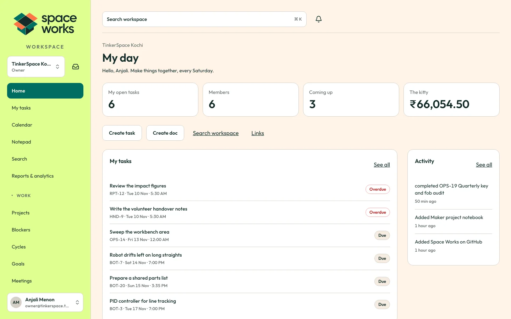<p><strong>My day.</strong> Tasks, meetings, dues and activity.</p></td>
    <td width="50%" valign="top">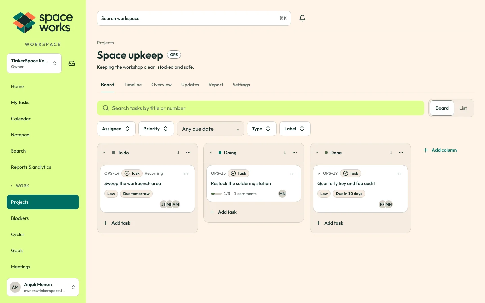<p><strong>Project board.</strong> Milestones, blockers and the next build.</p></td>
  </tr>
  <tr>
    <td width="50%" valign="top">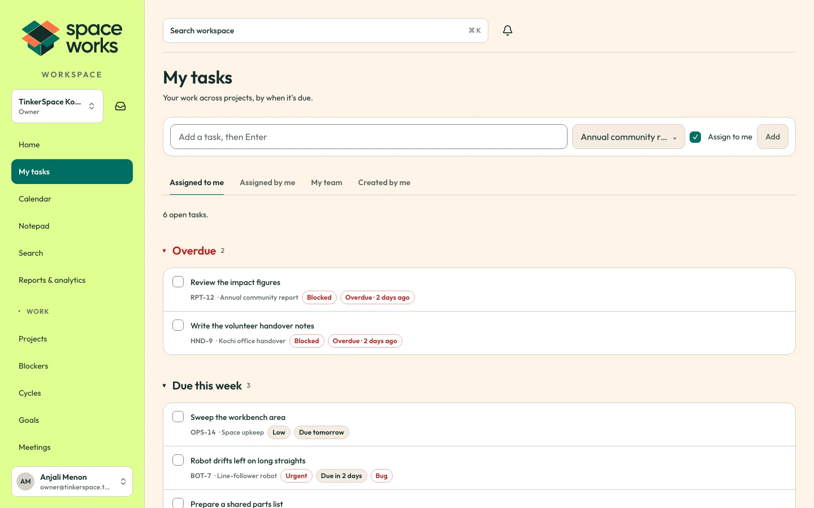<p><strong>My tasks.</strong> Assigned to me, assigned by me, my team and created by me.</p></td>
    <td width="50%" valign="top">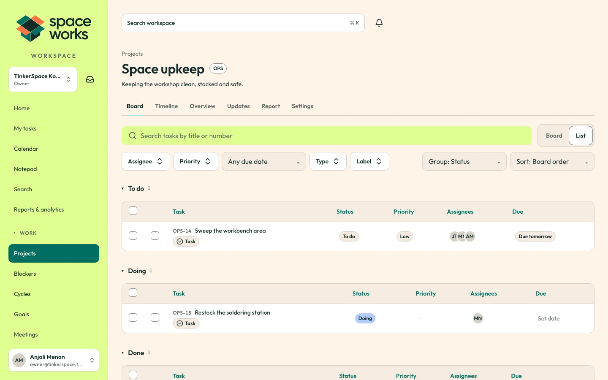<p><strong>Task list.</strong> Inline editing, grouping and bulk edit.</p></td>
  </tr>
  <tr>
    <td width="50%" valign="top">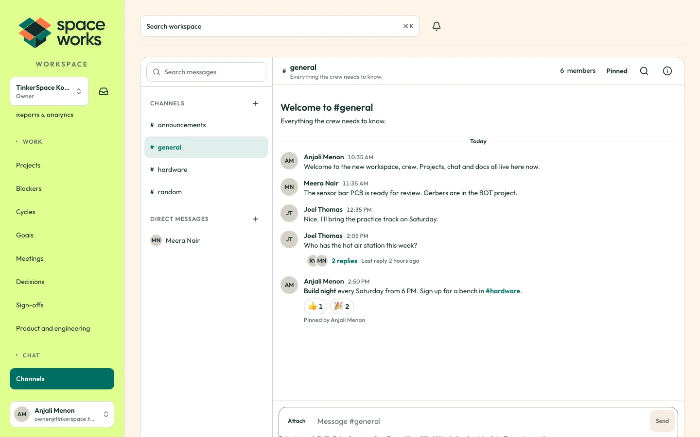<p><strong>Chat.</strong> Channels, threads and conversations.</p></td>
    <td width="50%" valign="top">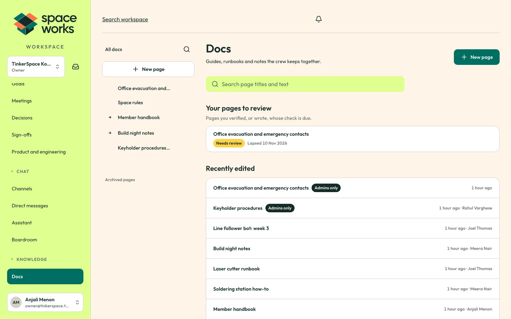<p><strong>Docs.</strong> SOPs with history and controlled access.</p></td>
  </tr>
  <tr>
    <td width="50%" valign="top">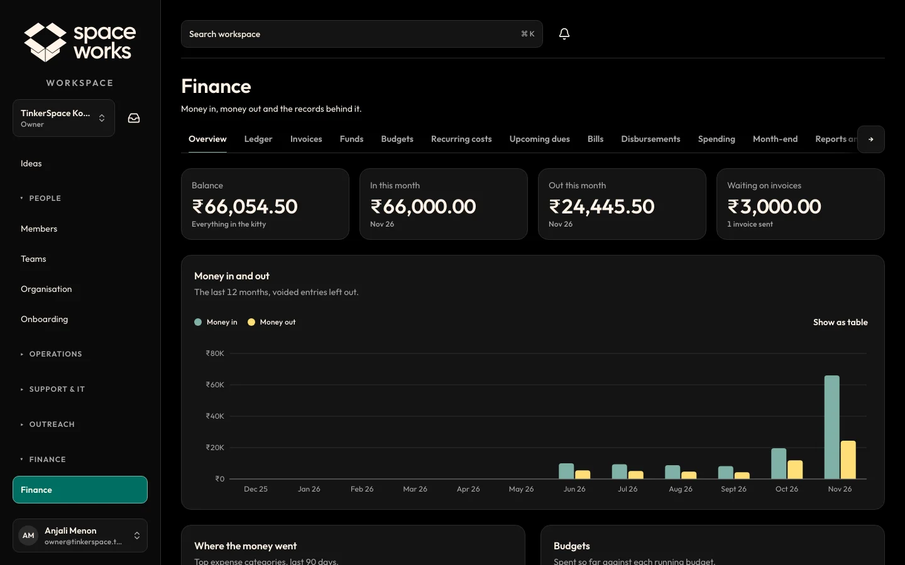<p><strong>Finance, dark mode.</strong> Funds, bills and spending.</p></td>
    <td width="50%" valign="top">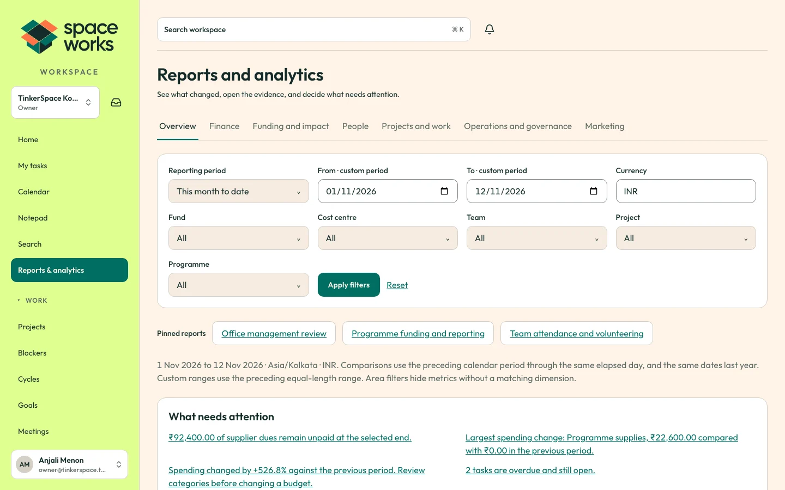<p><strong>Reports.</strong> Comparisons, drill-downs and board packs.</p></td>
  </tr>
  <tr>
    <td width="50%" valign="top">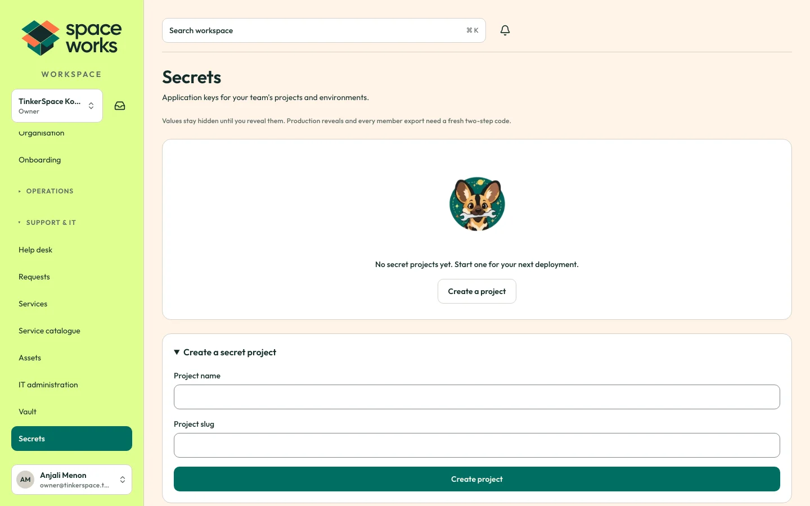<p><strong>Secrets.</strong> Environments, masked values and audited reveal.</p></td>
    <td width="50%" valign="top">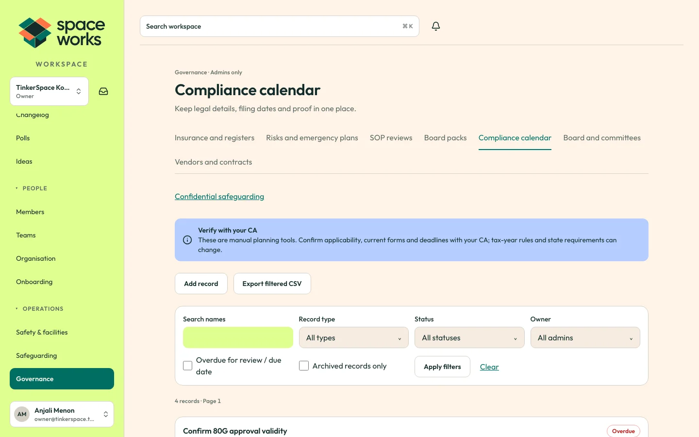<p><strong>Governance.</strong> Compliance dates, decisions and registers.</p></td>
  </tr>
</table>

## Quick start

Requires Node.js 22.18 or newer and Docker. The development Compose file provides
PostgreSQL 16, Redis 7, private Silo storage and Mailpit for captured email.

```bash
git clone --recurse-submodules https://github.com/SpaceWorks-Labs/SpaceWorks-Workspace.git
cd SpaceWorks-Workspace
npm ci
cp .env.example .env
docker compose up -d --wait
npm run db:deploy
npm run storage:init
DEMO_PASSWORD='choose-12-or-more-characters' npm run db:seed:demo
PORT=3290 npm run dev:stack
```

The `design-kit/` submodule is optional: builds use the generated files that are
committed, so a plain `git clone` works too. Set `AUTH_URL` and
`NEXT_PUBLIC_BASE_URL` to `http://localhost:3290`, open it and sign in as
`owner@tinkerspace.test` with your demo password. Captured email is at
`http://localhost:8025`. Without a seed, open `/setup` to create the first
workspace. Details, including PowerShell and `local.sh`, are in
[Local development](docs/DEVELOPMENT.md).

## Deploy

On a 64-bit Linux VPS the installer asks every question first and changes
nothing until you confirm. It sets up Docker, generates secrets, pulls the
release images and runs migrations, with updates, rollback, encrypted backups
and recovery in the same menu:

```bash
curl -fsSL https://raw.githubusercontent.com/SpaceWorks-Labs/SpaceWorks-Workspace/main/install.sh | bash
```

Prefer to read it first: download `install.sh`, review it, then run
`bash install.sh`. Needs 2 vCPU, 4 GB RAM, DNS records for the host names, ports
80 and 443, and an SMTP relay.

| Target | Guide |
| --- | --- |
| VPS with Docker, Caddy HTTPS, worker and beat (recommended) | [DEPLOYMENT_VPS.md](docs/DEPLOYMENT_VPS.md) |
| Netlify frontend with a VPS backend | [DEPLOYMENT_SPLIT.md](docs/DEPLOYMENT_SPLIT.md) |
| Docker with managed PostgreSQL, Redis and storage | [DEPLOYMENT_DOCKER.md](docs/DEPLOYMENT_DOCKER.md) |
| Render, Supabase, Upstash, R2 and Cloudflare cron | [DEPLOYMENT_CLOUD.md](docs/DEPLOYMENT_CLOUD.md) ([Blueprint](render.yaml), [cron Worker](deploy/cloudflare-cron/README.md)) |
| AWS | [DEPLOYMENT_AWS.md](docs/DEPLOYMENT_AWS.md) |
| Kubernetes with Helm | [DEPLOYMENT_KUBERNETES.md](docs/DEPLOYMENT_KUBERNETES.md) ([chart](charts/spaceworks-workspace/README.md)) |
| DigitalOcean App Platform | [.do/app.yaml](.do/app.yaml) |
| Isolated staging | [DEPLOYMENT_STAGING.md](docs/DEPLOYMENT_STAGING.md) |

Sign-in providers, default limits, observability and metrics are optional and
off by default; their environment variables and instance settings are listed in
[Configuration](docs/CONFIGURATION.md#instance-settings-and-their-environment-fallbacks).

Images and versions are explained in [CONTAINER_IMAGES.md](docs/CONTAINER_IMAGES.md);
shipping and running a release in [PRODUCTION_RELEASE.md](docs/PRODUCTION_RELEASE.md)
and [production-operations.md](docs/production-operations.md).

## Secrets CLI

The `sww` command line and Node SDK are published to GitHub Packages, which
requires authentication even for public packages. Use Node 20 or newer:

```bash
npm login --scope=@spaceworks-labs --auth-type=legacy --registry=https://npm.pkg.github.com
npm install --global @spaceworks-labs/workspace-cli
sww login --host https://workspace.example.org
sww init --project PROJECT_ID --env dev
sww run --env dev -- npm run dev
```

Enter a GitHub personal access token (classic) with `read:packages` only at the
password prompt. The [CLI guide](packages/cli/README.md) covers CI machine
identities, export, the SDK, keychain storage and secret scanning.

## Design system

The look comes from [Design-Kit](https://github.com/SpaceWorks-Labs/Design-Kit),
included as the shallow git submodule `design-kit/`. `npm run tokens:sync`
regenerates `app/styles/palette.css`, `app/styles/motion.css` and the token
fixture from it; the generated files are committed, so builds never need the
submodule. Type is Outfit for body and UI, Gilroy ExtraBold for display and one
Unbounded accent phrase. Light mode (Warm Cream) is the default; dark mode is solid black and one click away.

| | Colour | Used for |
| --- | --- | --- |
|  | Deep Ink | Text and dark surfaces |
|  | Warm Cream | Canvas and inverse labels |
|  | Maker Teal | Actions, links and focus |
|  | Workshop Orange | Accent fill with an ink label |
|  | Citron | Selection and highlights |

Read [the design guide](docs/DESIGN.md). `npm run readme:art` regenerates the
banners (`docs/readme/banner*.svg` to 2x PNG) and swatches.

## Architecture at a glance

A Next.js 16 App Router application backed by PostgreSQL through Prisma. Pages
and Server Actions authenticate, then call business rules in `lib/`; every query
is scoped to a workspace and a role. Redis backs rate limits, realtime and the
BullMQ queue; a worker sends email and notifications and runs syncs, and beat
schedules recurring jobs. Files live in private S3-compatible storage (Silo).
The website can also render on Netlify through a private gateway. See
[ARCHITECTURE.md](docs/ARCHITECTURE.md).

## Documentation

| Read this | When you want to |
| --- | --- |
| [Documentation index](docs/README.md) | Find area guides and engineering references |
| [Development](docs/DEVELOPMENT.md) and [Configuration](docs/CONFIGURATION.md) | Run it locally and look up settings |
| [Organisation governance](docs/areas/org-governance.md) and [Observability](docs/OBSERVABILITY.md) | Run several organisations, set limits and add metrics |
| [MCP](docs/MCP.md) and [REST API](docs/API.md) | Connect AI clients and scripts |
| [Design](docs/DESIGN.md) | Follow the brand and UI rules |
| [Audit, November 2026](docs/AUDIT-2026-11.md) | See findings and open work |

## Codebase size

About 243,000 lines of hand-written source, tests, SQL and docs across about
3,060 files (0.10.0). That covers 244 pages, 89 route handlers, 427 Server
Actions, 288 Prisma models in 38 migrations and 19 feature modules. The suite
has 162 unit test files (about 4,500 tests), 96 PostgreSQL integration test
files (950 tests) and 8 Playwright specs. Run `npm run loc` for the current
breakdown by language and area; the
[November 2026 audit](docs/AUDIT-2026-11.md#codebase-size) records the numbers
at that date.

## Contributing

Read [CONTRIBUTING.md](CONTRIBUTING.md) and [AGENTS.md](AGENTS.md). Features
branch from `dev`; `main` is production. Keep every file at 300 lines or fewer,
tenant and role checks on the server, and credentials out of issues and logs.

## Security

There is no standalone policy file. Report vulnerabilities through GitHub's
private vulnerability reporting (Security, then Report a vulnerability), never
in a public issue; see [CONTRIBUTING.md](CONTRIBUTING.md#security-issues).
Operational hardening is covered in [production-operations.md](docs/production-operations.md).

## Licence

Made by **Space Works**, a maker community that started inside TinkerSpace
Kochi. Licensed [AGPL-3.0-or-later](LICENSE): if you modify and host it, offer
the matching source to the people using your version. Third-party notices are in
[NOTICE](NOTICE).
